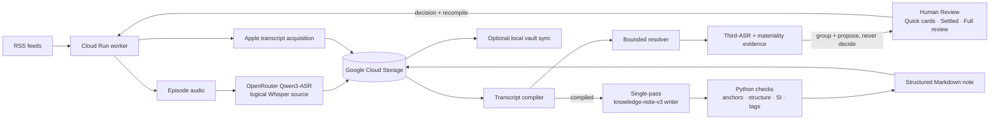
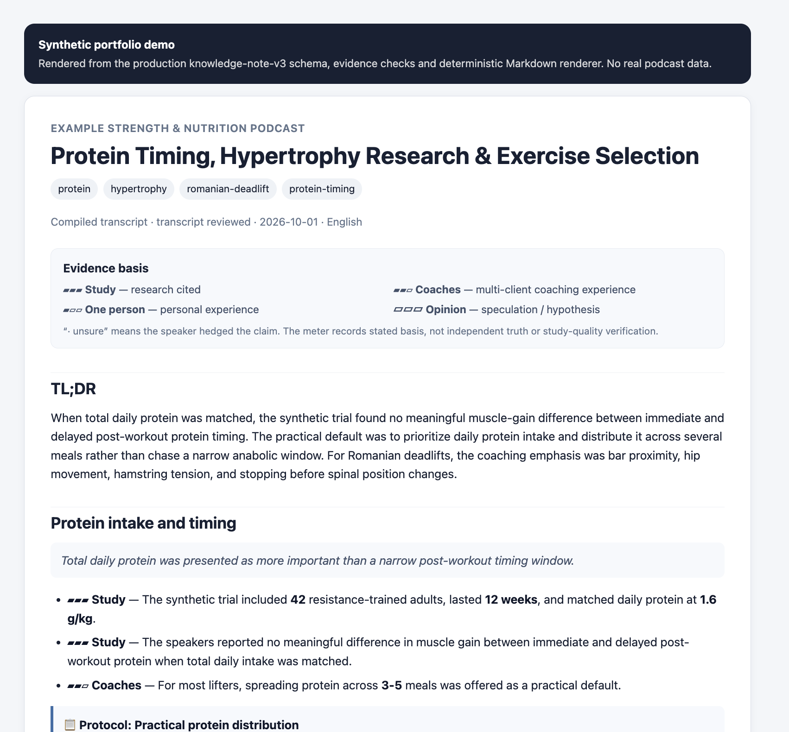

# Podcast Automation

[](https://github.com/wintersyntax/podcast-automation/actions/workflows/portfolio-ci.yml)


A resumable automation pipeline for evidence-heavy **exercise science, training and nutrition podcasts**. It combines independent transcript sources, preserves disagreements as evidence, routes ambiguous cases to human review, and produces durable structured knowledge notes.

This repository is a curated portfolio version of a larger private production project. Deployment-specific identifiers, personal paths, real podcast feed configuration and transcript-derived evaluation corpora are excluded or replaced with synthetic examples.

## Engineering highlights

- deduplicates evidence-based republished episodes before unnecessary downstream work
- defers one episode on a transient transcription-provider outage without blocking other episodes, with bounded alerting
- durable Human Review replay, independent feedback saving, bounded audio retention and checkable Vault delivery receipts
- read-only PodcastOps episode projection and a separately hosted synthetic demo

- resumable RSS-driven episode processing with durable GCS-backed state
- independent Apple Podcasts and OpenRouter `qwen/qwen3-asr-1.7b` transcript acquisition with bounded chunking, retry and spend accounting
- transcript alignment and conservative multi-source reconciliation
- deterministic evidence/provenance checks around bounded AI-assisted resolution
- explicit Human Review for material unresolved conflicts, with prefetched Third-ASR evidence and a materiality-first quick-review queue
- episode-level AI budget admission, settlement and provenance tracking
- single-pass, transcript-grounded `knowledge-note-v3` writer with deterministic publication checks
- Python-owned validation, tag resolution and deterministic metadata/frontmatter construction
- separate Cloud Run worker and Human Review service boundaries
- optional Slack signalling and macOS credential/sync helpers

## Current public snapshot and newer upstream work

**Source audited:** private `wintersyntax/podcast-worker` `main` at `d8678469077dd4b644fcc950562e10fd11ee730e` (15 October 2026).

This is a **curated source extraction**, not a private-repository mirror or a production deployment. The October 15 refresh ports the current episode pipeline, materiality/Review flow, single-pass note writer, and synthetic regression coverage for republished-episode detection, provider-outage deferral, bounded review-audio lifecycle, durable review feedback/replay, PodcastOps status projection, and checksum-bound Mac Vault receipts.

The private AI-assisted *software development* workspace was moved on 14 October to a separate private project (TASK-147). It is **not** a component of this podcast product and is not bundled here. Runtime AI-assisted transcript decisions remain bounded by the compiler, budgets and explicit Human Review.

The public branch also removes 69 obsolete legacy summary/benchmark files. Unlike the earlier October 7/12 extraction, current production modules are included, with sanitization. Private runner tooling, production configuration, account identities, real transcripts and evaluation evidence remain excluded. See [exact scope and exclusions](docs/UPSTREAM_STATUS.md).

## Domain focus

The system is tuned for long-form exercise and nutrition content where small transcription errors can change the meaning of the material being captured. The knowledge pipeline is designed to preserve and structure details such as:

- studies and papers mentioned by the speakers, including authors/year/name as heard, design, sample, duration and reported findings
- exercise selection, setup, execution and technique
- training variables, protocols, numerical recommendations and their conditions
- nutrition, supplementation, recovery and evidence-quality discussions
- practical takeaways while retaining whether a claim came from research, coaching experience, personal experience or another stated basis
- named sources and references for later retrieval

This makes the project intentionally more domain-aware than a generic podcast summarizer: the goal is to turn technical exercise/nutrition conversations into searchable notes without silently strengthening, normalizing or inventing what the speakers said.

## Why multiple transcript sources?

The historical `Whisper` source name is retained in storage/schema paths, but the current producer is OpenRouter `qwen/qwen3-asr-1.7b`. Producer identity includes the model and stitch policy, so artifacts from the earlier `whisper-large-v3` producer are not reused.

A fluent transcript is not necessarily a trustworthy transcript. Differences involving numbers, units, negations, names, citations or domain terminology can materially change meaning.

This system keeps independent sources separate, compares their evidence, resolves only what can be justified, and stops for human judgment when confidence is insufficient.

## Architecture



The important boundary is authority: model output can assist inside explicit contracts, but deterministic code owns identity, evidence IDs, budget accounting, state transitions, validation and publication gates. Unresolved speech evidence remains unresolved until a human decides it.

## Pipeline at a glance

1. Discover the latest configured RSS episode and resume older incomplete work, preserving durable state and duplicate decisions.
2. Download episode audio to ephemeral worker storage.
3. Generate the logical "Whisper" source with OpenRouter `qwen/qwen3-asr-1.7b` in bounded chunks, with provenance, budget reservations, seam-safe timestamp validation and bounded rate-limit backoff. Transient provider outages defer only the affected episode.
4. Detect republished audio/transcript evidence before unnecessary Apple or downstream processing; acquire an independent Apple transcript when available.
5. Store both source artifacts separately.
6. Align and compare the sources.
7. Apply deterministic equivalence/corroboration rules.
8. Use a bounded resolver only for eligible conflicts.
9. Prefetch bounded Third-ASR evidence for remaining cards and record a materiality verdict without granting either mechanism transcript authority.
10. Present Human Review as quick cards first, then one explicit settled-card confirmation, ordinary review for what remains, and finally recompile. Every stored choice remains an audited human decision.
11. Recompile after durable review decisions.
12. Generate a structured `knowledge-note-v3` note from the canonical transcript through the verified single-pass knowledge-writer preset; the same response carries topics, people and tag proposals.
13. Validate structure and transcript anchors in Python, remove unsupported units/sponsor/stub content, convert marked quantities to SI, resolve tags and render the Markdown body deterministically.
14. Construct frontmatter in Python and publish only after those checks pass.

## PodcastOps status dashboard — synthetic demo

The source extraction includes the read-only episode-status projection and dashboard frontend. The published demo uses a **separate loopback-only synthetic server**, with 12 fictional episodes rather than private Google Cloud records. The demo illustrates review queues, prepared summaries, local Mac Vault delivery confirmation, pending sync and unavailable evidence.


*Screenshot of the local synthetic demo: 12 fictional episodes, with review, summary and Mac Vault delivery states. “Mac copy confirmed” verifies a reported local copy at that time, not remote iCloud upload.*

Run `python scripts/demo_ops_dashboard.py` and open `http://127.0.0.1:8767/ops`. The demo does not authenticate to, access or deploy the private production backend or read production data. See the [PodcastOps synthetic demo guide](docs/DEMO_PODCASTOPS.md) for screenshot and safety instructions.

## Human Review

The same Flask review application can run locally or as a separate service. Review state is durable and generation-aware; bounded replay preserves compatible human decisions across recompilation, and feedback notes are saved independently. Recompile requests carry correlation identifiers so a later worker execution can continue the intended episode/review generation.


*The synthetic demo mirrors the current materiality-first flow: a control sample, a quick source choice, an evidence-backed proposal, one-click confirmation of filter-settled cards, and a protected **42 vs 40 participants** conflict that still requires an explicit human decision. Third-ASR and materiality evidence can reduce review work, but they never write canonical transcript text on their own.*

Current Human Review uses a materiality-first queue. Low-impact cards can be presented as a control sample, a fast Apple/Whisper choice, or a one-click proposal; cards the filter cannot safely simplify stay in ordinary review. A 10% control sample (at least two cards, excluding representation-only classes) checks the filter in real use. Third-ASR and older tier/batch/assisted surfaces remain advisory and are kept under advanced controls. The system never silently turns those signals into canonical transcript text.

Synthetic fixtures in `tests/fixtures/synthetic/` demonstrate the same review boundary without publishing real podcast transcript material.

## Knowledge-note output

The final knowledge artifact is static, so a GIF is not necessary here. The repository includes both a visual preview and a fully synthetic Markdown example rendered from the production note schema and deterministic renderer:



**[Open the generated knowledge-note example](examples/demo-knowledge-note.md)**

It shows the parts this project is designed to preserve for exercise/nutrition podcasts: research discussed, evidence-basis labels, training/nutrition protocols, exercise technique, numerical recommendations, takeaways, tags and sources mentioned.

The evidence meter describes **what basis the speaker gave for a claim**, not an independent rating of whether the claim is true or whether a cited study is high quality:

- **▰▰▰ Study** — the speaker explicitly cites research, a study, review or paper.
- **▰▰▱ Coaches** — coaching experience across multiple clients/athletes, or expert consensus reported by the speaker.
- **▰▱▱ One person** — one person's own experience or anecdote.
- **▱▱▱ Opinion** — hypothesis, speculation, or an "I think / I'd guess" claim without another stated basis.
- **· unsure** — appended when the speaker themselves hedges or expresses uncertainty.
- Purely descriptive bullets carry no evidence-basis label.

A **Study** label therefore means "research was cited in the episode"; it does **not** mean the system independently verified the paper, methodology or conclusion.

The screenshot provides a quick visual overview, while the rendered Markdown remains the primary inspectable artifact because it can be read, searched and reviewed directly.

## Repository layout

```text
podcast_engine/        production orchestration, state, review and knowledge pipeline
compiler/              transcript alignment, comparison and adjudication logic
macos_agent/           optional local credential maintenance and sync helpers
slack_ack/             small signed-request acknowledgement service
security/              narrow IAM/reference policy helpers
prompts/               versioned knowledge/evaluation prompts
scripts/               bounded operator and maintenance tools
tests/                 curated unit/integration tests plus synthetic fixtures
config/                safe example/runtime policy configuration
docs/                  public architecture and deployment documentation
examples/launchd/      sanitized macOS launch-agent examples
```

## Documentation

- [Architecture](docs/ARCHITECTURE.md)
- [Transcript pipeline](docs/TRANSCRIPT_PIPELINE.md)
- [Human Review](docs/HUMAN_REVIEW.md)
- [Synthetic Human Review demo](docs/DEMO_HUMAN_REVIEW.md)\n- [Synthetic PodcastOps dashboard demo](docs/DEMO_PODCASTOPS.md)
- [Synthetic knowledge-note demo](docs/DEMO_KNOWLEDGE_NOTE.md)
- [Knowledge generation](docs/KNOWLEDGE_GENERATION.md)
- [Setup](docs/SETUP.md)
- [Deployment](docs/DEPLOYMENT.md)
- [Security and privacy](docs/SECURITY_AND_PRIVACY.md)
- [Public extraction scope and upstream status](docs/UPSTREAM_STATUS.md)

## Configuration

The checked-in podcast configuration is intentionally disabled and synthetic. Start from `config/podcasts.example.json` and `.env.example`.

The committed OpenRouter preset lock is an example identity, not a production preset. The current knowledge-generation architecture requires a verified `PODCAST_KNOWLEDGE_WRITER_PRESET` for the single-pass `knowledge-note-v3` writer. Optional review tuning is controlled through the Third-ASR/materiality environment switches documented in `.env.example`.

## Public-repository safety

Production API keys, OAuth secrets, Slack secrets/webhooks, Apple tokens, resource identifiers, personal allowlists, local paths, feed configuration and real transcript/evaluation data are deliberately excluded. Public CI runs `scripts/check_public_release.py` across tracked files to reject known credential formats, production identities and private workflow/evidence paths. The scanner is a backstop, not a substitute for human review.

## Future direction

The current pipeline is designed to produce durable, source-grounded knowledge notes that can later support semantic search and retrieval-augmented generation (RAG). A future phase could index the structured notes, studies, exercises, recommendations, topics and cited sources so questions can be answered across the podcast library while preserving links back to the underlying evidence.

The goal would not be to replace the grounded note pipeline, but to use it as the trusted retrieval layer for cross-episode search and synthesis.

## Development approach

This project was developed with substantial **AI-assisted software development**, but the separate Cline/Host/Semantic-Auditor engineering workspace was extracted into its own private repository and is not shipped in this portfolio. AI tools were used throughout architecture exploration, implementation, test generation and repair, code review, and iterative design. The domain goals, workflow requirements, acceptance criteria, evaluation, integration, and final decisions were shaped iteratively through that human-AI process; this repository is not presented as if every implementation or design idea was independently authored from scratch.

## Project status

**Active public extraction.** The private production project operates separately. The public repository is a sanitized, testable portfolio version of its podcast product code as of 15 October 2026, not a production deployment.

Recent work moved the review path from a flat card list toward a materiality-first workflow: Third-ASR evidence can be prefetched before review, harmless differences are separated from truly material conflicts, quick choices are staged before one final save, and each session records bounded audit evidence for later tuning. Protected cases such as differing values, negations, citations and domain-sensitive semantics remain fail-closed.

The private project continues to refine transcript evidence, reviewer workload and note quality. Public `Portfolio CI` separates **Publication safety**, **Dependency** and **Application** checkpoints; private self-hosted runners and exact-main provenance tooling are intentionally not copied. Semantic search and RAG over source-grounded notes remain a **future direction**, not a feature shipped in this public snapshot.


## License

Released under the [MIT License](LICENSE).
