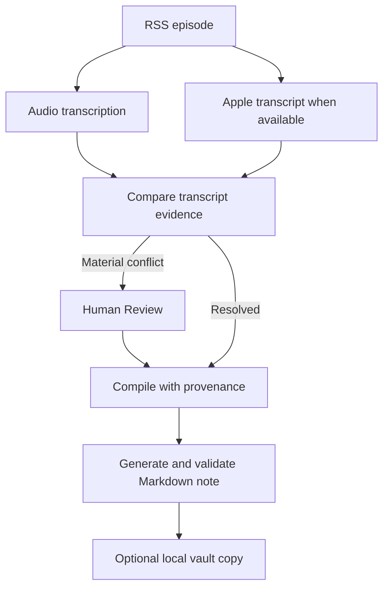
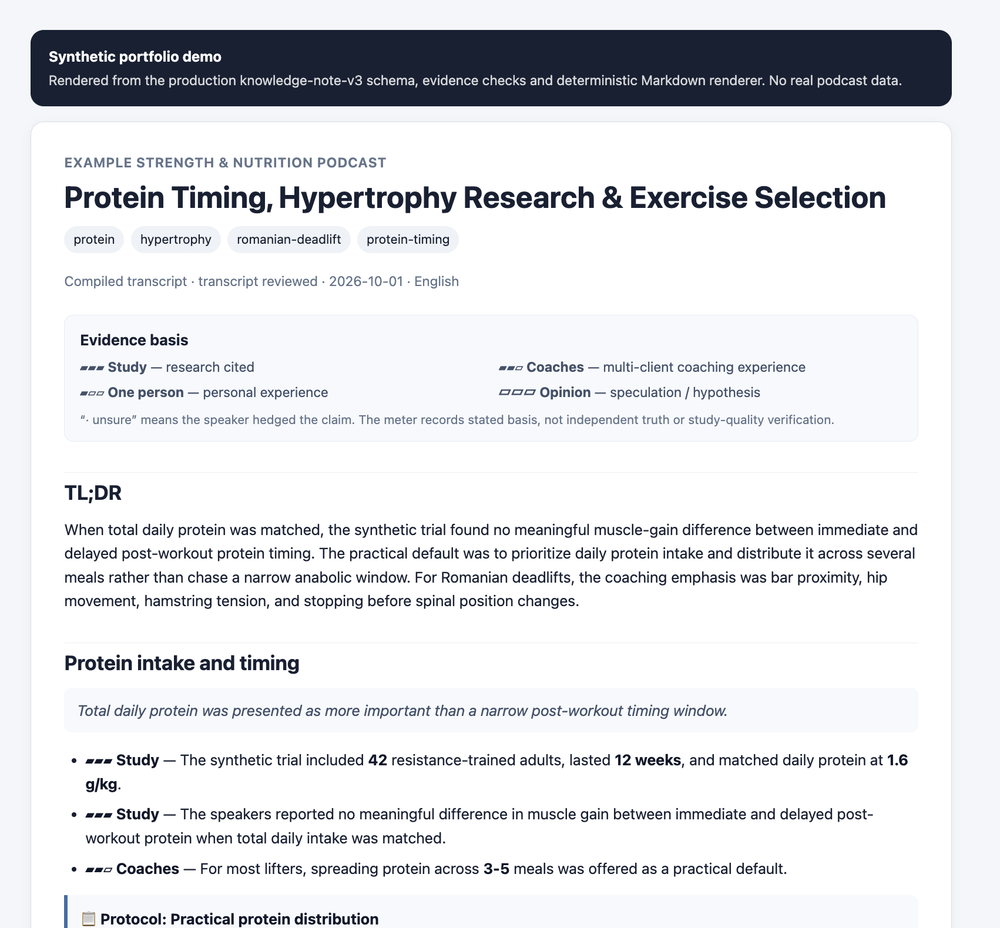

# Podcast Automation

[](https://github.com/wintersyntax/podcast-automation/actions/workflows/portfolio-ci.yml)


**From long exercise-science and nutrition podcasts to structured notes with a traceable source.**

## The problem and idea

Useful training and nutrition information is scattered through hours of conversation. A fluent transcript can still get a number, name or condition wrong, and a summary can hide that mistake. I built a pipeline that compares transcript evidence before turning an episode into reusable knowledge notes, with human decisions for unresolved material disagreements.

## How it works

A resumable Python worker discovers RSS episodes, transcribes audio through OpenRouter Qwen3-ASR and acquires an independent Apple transcript when available. Deterministic alignment and validation constrain model assistance. Human Review preserves explicit choices and their provenance; a checked writer then produces Markdown notes with research mentioned, protocols, quantities and source anchors.



Persistent episode state supports retries and provider outages. A read-only dashboard exposes progress, while bounded model calls, validation and API-key expiry warnings support operation. The implementation uses Python, Flask, Google Cloud Storage and Cloud Run; optional macOS helpers copy completed notes locally.

## See it in action



*Fictional content illustrates the structured note format. Notes preserve what speakers said; cited research is not independently verified.*

Explore the [example note](examples/demo-knowledge-note.md), [Human Review demo](docs/HUMAN_REVIEW.md) or [synthetic dashboard](docs/DEMO_PODCASTOPS.md).

After installing the [documented dependencies](docs/SETUP.md), run one local synthetic demo:

```bash
python scripts/demo_knowledge_note.py
# Open http://127.0.0.1:8766
```

## Explore the implementation

[Implementation guide](docs/IMPLEMENTATION_GUIDE.md) · [Architecture](docs/ARCHITECTURE.md) · [Transcript pipeline](docs/TRANSCRIPT_PIPELINE.md) · [Knowledge generation](docs/KNOWLEDGE_GENERATION.md) · [Public extraction scope](docs/UPSTREAM_STATUS.md)

## Current scope

This is a curated public edition of real pipeline code, with synthetic demos and tests. Credentials, real transcripts, private account configuration and deployment history are excluded. The public demo needs no production account. Cross-episode semantic search and RAG remain future work.

Application code: [MIT](LICENSE). Exercise lexicon: CC BY-SA 4.0; see [third-party notices](THIRD_PARTY_NOTICES.md).
