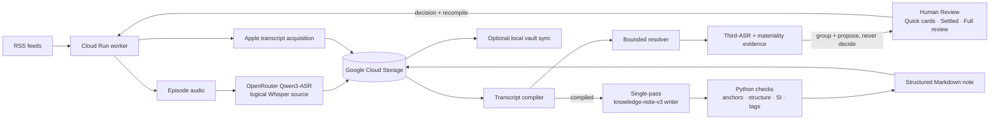
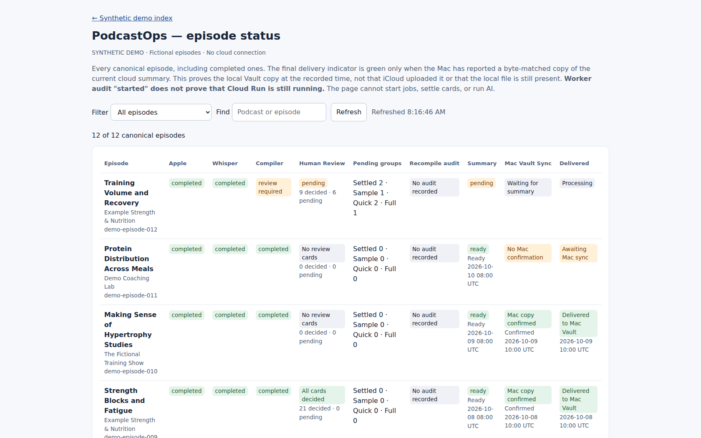
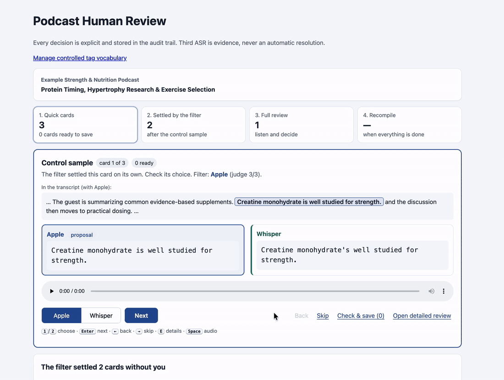

# Podcast Automation

[](https://github.com/wintersyntax/podcast-automation/actions/workflows/portfolio-ci.yml)


A resumable automation pipeline for evidence-heavy **exercise science, training and nutrition podcasts**. It combines independent transcript sources, preserves disagreements as evidence, routes ambiguous cases to human review, and produces durable structured knowledge notes.

This is a public portfolio edition of a larger production system. All published demos use synthetic data.

## Engineering highlights

- **Resumable processing:** RSS discovery, duplicate detection, persistent episode state and per-episode deferral during provider outages.
- **Multiple transcripts:** Apple Podcasts where available and OpenRouter Qwen3-ASR, with bounded chunks, retries, timestamp checks, provenance and AI-spend accounting.
- **Conservative reconciliation:** deterministic alignment checks, bounded AI assistance and explicit Human Review of unresolved material conflicts.
- **Faster review:** quick choices, materiality filtering, advisory Third-ASR evidence, durable decisions and feedback replay.
- **Grounded Markdown notes:** a single-pass writer, transcript-anchor checks, SI conversion, structured topics/tags and deterministic rendering.
- **Operational visibility:** read-only PodcastOps status, audio-retention controls, optional notifications and checksum-based local Vault receipts.

## About this edition

This repository contains a **privacy-safe public edition** of a larger production system. The source is real product code; the demos, example feeds and knowledge-note content are fictional. Production credentials, account-specific configuration and real transcripts are not included.

For a concise overview of progress, see the [development changelog](CHANGELOG.md).

## Domain focus

The pipeline is designed for exercise-science and nutrition discussions, where incorrect numbers, names, study references and conditions can change the meaning of a recommendation. Notes retain research discussed, exercise technique, training and nutrition protocols, numerical recommendations and the speaker's stated basis for a claim.

## Why multiple transcript sources?

Fluent transcription is not necessarily accurate. Independent readings stay separate, deterministic rules compare their evidence, a bounded resolver handles eligible cases and uncertain material conflicts go to Human Review. The internal storage name `Whisper` is historical; current ASR uses OpenRouter `qwen/qwen3-asr-1.7b`.

## Architecture



The important boundary is authority: model output can assist inside explicit contracts, but deterministic code owns identity, evidence IDs, budget accounting, state transitions, validation and publication gates. Unresolved speech evidence remains unresolved until a human decides it.

## Pipeline at a glance

1. Discover new RSS episodes and resume incomplete processing from durable state.
2. Transcribe audio and acquire an independent Apple transcript when available.
3. Align and reconcile sources conservatively; route material disagreements to Human Review.
4. Preserve human decisions, recompile and keep the source/provenance trail.
5. Generate a single-pass, transcript-grounded knowledge note; validate and render it in Python.
6. Expose read-only status and optional vault-copy receipts.

A transient transcription outage can defer one episode without blocking the others. More detail: [Architecture](docs/ARCHITECTURE.md).

## PodcastOps status dashboard — synthetic demo

The source extraction includes the read-only episode-status projection and dashboard frontend. The published demo uses a **separate loopback-only synthetic server**, with 12 fictional episodes rather than private Google Cloud records. The demo illustrates review queues, prepared summaries, local Mac Vault delivery confirmation, pending sync and unavailable evidence.



*Screenshot of the local synthetic demo: 12 fictional episodes, with review, summary and Mac Vault delivery states. “Mac copy confirmed” verifies a reported local copy at that time, not remote iCloud upload.*

Run `python scripts/demo_ops_dashboard.py` and open `http://127.0.0.1:8767/ops`. The demo does not authenticate to, access or deploy the private production backend or read production data. See the [PodcastOps synthetic demo guide](docs/DEMO_PODCASTOPS.md) for screenshot and safety instructions.

## Human Review

The same Flask review application can run locally or as a separate service. Review state is durable and generation-aware; bounded replay preserves compatible human decisions across recompilation, and feedback notes are saved independently. Recompile requests carry correlation identifiers so a later worker execution can continue the intended episode/review generation.



*The synthetic demo mirrors the current materiality-first flow: a control sample, a quick source choice, an evidence-backed proposal, one-click confirmation of filter-settled cards, and a protected **42 vs 40 participants** conflict that still requires an explicit human decision. Third-ASR and materiality evidence can reduce review work, but they never write canonical transcript text on their own.*

Current Human Review uses a materiality-first queue. Low-impact cards can be presented as a control sample, a fast Apple/Whisper choice, or a one-click proposal; cards the filter cannot safely simplify stay in ordinary review. A 10% control sample (at least two cards, excluding representation-only classes) checks the filter in real use. Third-ASR and older tier/batch/assisted surfaces remain advisory and are kept under advanced controls. The system never silently turns those signals into canonical transcript text.

Synthetic fixtures in `tests/fixtures/synthetic/` demonstrate the same review boundary without publishing real podcast transcript material.

## Knowledge-note output

Knowledge notes are **inspectable Markdown** containing research mentioned, technique, protocols, numbers, tags and references.

**[Open the synthetic knowledge-note example](examples/demo-knowledge-note.md)**, or run `python scripts/demo_knowledge_note.py` to see a [local preview](http://127.0.0.1:8766). Both use invented source material; no model or cloud service is called.

Claim labels show **what basis the speaker gave**, not an independent score of scientific quality:

- **🔬 Study** — research, a study, review or paper explicitly cited.
- **🏋️ Coaches** — multi-client coaching experience or reported expert consensus.
- **👤 One person** — one person's experience or an anecdote.
- **💬 Opinion** — speculation or a hypothesis without another stated basis.
- **· unsure** — appended when the speaker hedges; descriptive statements carry no label.

A **🔬 Study** label means research was *cited*, not that the system verified its methodology or conclusions. See the [knowledge-note demo guide](docs/DEMO_KNOWLEDGE_NOTE.md).

## Repository layout

```text
podcast_engine/        production orchestration, state, review and knowledge pipeline
compiler/              transcript alignment, comparison and adjudication logic
macos_agent/           optional local credential maintenance and sync helpers
slack_ack/             small signed-request acknowledgement service
security/              narrow IAM/reference policy helpers
prompts/               versioned knowledge/evaluation prompts
scripts/               bounded operator and maintenance tools
tests/                 curated unit/integration tests plus synthetic fixtures
config/                safe example/runtime policy configuration
docs/                  public architecture and deployment documentation
examples/launchd/      sanitized macOS launch-agent examples
```

## Documentation

[Architecture](docs/ARCHITECTURE.md) · [Transcript pipeline](docs/TRANSCRIPT_PIPELINE.md) · [Human Review](docs/HUMAN_REVIEW.md) · [Knowledge generation](docs/KNOWLEDGE_GENERATION.md) · [Setup](docs/SETUP.md) · [Deployment](docs/DEPLOYMENT.md) · [Security and privacy](docs/SECURITY_AND_PRIVACY.md)

Local synthetic demos: `python scripts/demo_ops_dashboard.py` (port 8767), `python scripts/demo_human_review.py` (port 8765) or `python scripts/demo_knowledge_note.py` (port 8766). Install `requirements.txt` and `requirements.review.txt` first; run each server separately.

## Configuration

The checked-in podcast configuration is intentionally disabled and synthetic. Start from `config/podcasts.example.json` and `.env.example`.

The committed OpenRouter preset lock is an example identity, not a production preset. The current knowledge-generation architecture requires a verified `PODCAST_KNOWLEDGE_WRITER_PRESET` for the single-pass `knowledge-note-v3` writer. Optional review tuning is controlled through the Third-ASR/materiality environment switches documented in `.env.example`.

## Public-repository safety

Production API keys, OAuth secrets, Slack secrets/webhooks, Apple tokens, resource identifiers, personal allowlists, local paths, feed configuration and real transcript/evaluation data are deliberately excluded. Public CI runs `scripts/check_public_release.py` across tracked files to reject known credential formats, production identities and private workflow/evidence paths. The scanner is a backstop, not a substitute for human review.

## Future direction

The current pipeline is designed to produce durable, source-grounded knowledge notes that can later support semantic search and retrieval-augmented generation (RAG). A future phase could index the structured notes, studies, exercises, recommendations, topics and cited sources so questions can be answered across the podcast library while preserving links back to the underlying evidence.

The goal would not be to replace the grounded note pipeline, but to use it as the trusted retrieval layer for cross-episode search and synthesis.

## Development approach

The system was developed through human-directed design, requirements, evaluation, testing and AI-assisted programming. Source and regression tests are included so its capabilities and limitations can be inspected.

## Project status

**Actively developed.** This is a sanitized public portfolio edition with local synthetic demos, not an authenticated production deployment. Cross-episode semantic search and RAG are possible future extensions, not features shipped today.

See the [selected development milestones](CHANGELOG.md).

## License

Released under the [MIT License](LICENSE).
